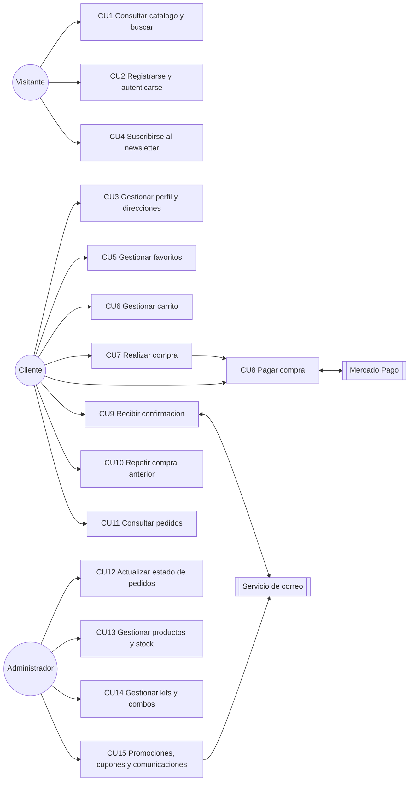

# Diagramas del proyecto

Archivos de texto con sintaxis Mermaid. Se renderizan en el editor de
Figma / VS Code con la extension "Markdown Preview Mermaid Support", o
directamente en GitHub / GitLab.

- seccion inferior → diagrama de clases UML (Entregable 2, v1.0)
- `diagrama-mer.md` → modelo relacional efectivamente implementado

---

## Diagrama de clases (UML)

Notacion: `*` = multiplicidad many, `1` = uno, `0..1` = opcional,
`0..3` = hasta tres, `1..*` = al menos uno.

```mermaid
classDiagram
    direction TB

    class Usuario {
        <<abstracta>>
        +String id
        +String usuario
        +String correo
        +RolUsuario rol
    }

    class Cliente {
        +String nombre
        +String apellido
        +String telefono
        +Integer dni
    }

    class Direccion {
        +String id
        +String destinatario
        +String calle
        +String numero
        +String ciudad
        +String provincia
        +String codigoPostal
    }

    class Producto {
        +String id
        +String sku
        +String nombre
        +String descripcion
        +String marca
        +Categoria categoria
        +Decimal precioVenta
        +Decimal costoCompra
        +String garantia
        +String estado
    }

    class Kit {
        +Integer stockCalculado
    }

    class VarianteProducto {
        +String id
        +String talle
        +String color
        +String material
        +Integer stockActual
    }

    class EtiquetaUso {
        +String id
        +String nombre
    }

    class Proveedor {
        +String id
        +String razonSocial
        +String cuit
        +String nombreContacto
        +String telefono
        +String email
        +String direccion
        +String estado
    }

    class Carrito {
        +String id
        +DateTime fechaCreacion
        +DateTime reservaExpiracion
    }

    class ItemCarrito {
        +Integer cantidad
    }

    class Pedido {
        +String id
        +DateTime fechaCreacion
        +EstadoPedido estado
        +Decimal costoEnvio
        +Decimal montoTotal
    }

    class ItemPedido {
        +Integer cantidad
        +Decimal precioUnitario
    }

    class Cupon {
        +String codigo
        +Decimal porcentajeDescuento
        +Date fechaVigencia
        +Boolean activo
    }

    class Promocion {
        +String id
        +String nombre
        +Decimal porcentajeDescuento
        +Date fechaInicio
        +Date fechaFin
    }

    class SuscripcionNewsletter {
        +String correo
        +DateTime fechaSuscripcion
        +Boolean activo
    }

    class MovimientoStock {
        +String id
        +DateTime fecha
        +TipoMovimiento tipo
        +Integer cantidad
        +String justificacion
        +String responsable
    }

    Usuario <|-- Cliente : specialises
    Producto <|-- Kit : specialises

    Producto "1" *-- "1..*" VarianteProducto : composicion fuerte
    Cliente "1" *-- "0..3" Direccion : composicion fuerte, RN-02
    Carrito "1" *-- "0..*" ItemCarrito : composicion fuerte
    Pedido "1" *-- "1..*" ItemPedido : composicion fuerte

    Kit "0..*" o-- "2..*" VarianteProducto : agregacion debil

    Proveedor "1" --> "0..*" Producto : association
    Proveedor "0..1" --> "0..*" MovimientoStock : association
    Cliente "1" --> "1" Carrito : association
    Cliente "1" --> "0..*" Pedido : association
    Cliente "0..*" --> "0..*" Producto : favoritos N:N
    Producto "0..*" --> "0..*" EtiquetaUso : N:N
    ItemCarrito "0..*" --> "1" VarianteProducto : association
    ItemPedido "0..*" --> "1" VarianteProducto : association
    Pedido "0..*" --> "1" Direccion : association
    Pedido "0..*" --> "0..1" Cupon : association
    Pedido "0..*" --> "0..*" Promocion : N:N
    MovimientoStock "0..*" --> "1" VarianteProducto : association
    SuscripcionNewsletter "0..1" --> "0..1" Cliente : association
```

### Diagrama de casos de uso (resumen de CU1 a CU15)


