# Modelo relacional implementado (ER)

Generado a partir de `prisma/schema.prisma`, que es la version real y
ejecutable del diagrama de clases. 23 tablas.

Para regenerar el SQL: `npm run db:sql` (imprime el DDL).

```mermaid
erDiagram
    CATEGORIA ||--o{ PRODUCTO : "clasifica"
    MARCA ||--o{ PRODUCTO : "de"
    PROVEEDOR ||--o{ PRODUCTO : "suministra (0..1)"
    PRODUCTO ||--|{ VARIANTE_PRODUCTO : "se descompone en"
    PRODUCTO ||--o| KIT : "es kit"
    KIT ||--|{ KIT_COMPONENTE : "se arma con"
    VARIANTE_PRODUCTO ||--o{ KIT_COMPONENTE : "es componente de"
    PRODUCTO ||--o{ PRODUCTO_ETIQUETA : "clasificado por"
    ETIQUETA_USO ||--o{ PRODUCTO_ETIQUETA : "etiqueta"

    USUARIO ||--o| CLIENTE : "se especializa en"
    CLIENTE ||--o{ DIRECCION : "guarda (max 3)"
    CLIENTE ||--o| CARRITO : "posee (1:1)"
    CARRITO ||--o{ ITEM_CARRITO : "contiene"
    VARIANTE_PRODUCTO ||--o{ ITEM_CARRITO : "apunta a"

    CLIENTE ||--o{ PEDIDO : "realiza"
    PEDIDO ||--|{ ITEM_PEDIDO : "consolida"
    VARIANTE_PRODUCTO ||--o{ ITEM_PEDIDO : "vendida como"
    PEDIDO }o--o| CUPON : "aplica (0..1)"
    PEDIDO ||--o{ PEDIDO_PROMOCION : "se beneficia"
    PROMOCION ||--o{ PEDIDO_PROMOCION : "aplicada en"
    PROMOCION ||--o{ PROMOCION_PRODUCTO : "acota a"
    PRODUCTO ||--o{ PROMOCION_PRODUCTO : "incluido en"

    CLIENTE ||--o{ FAVORITO : "marca"
    PRODUCTO ||--o{ FAVORITO : "guardado por"

    VARIANTE_PRODUCTO ||--o{ MOVIMIENTO_STOCK : "auditada por"
    USUARIO ||--o{ MOVIMIENTO_STOCK : "responsable"
    PROVEEDOR ||--o{ MOVIMIENTO_STOCK : "origen del ingreso (0..1)"
    PEDIDO ||--o{ MOVIMIENTO_STOCK : "origen de la venta (0..1)"

    USUARIO ||--o| SUSCRIPCION_NEWSLETTER : "vinculada (0..1)"

    PRODUCTO {
        string id PK
        string sku UK "unico"
        string nombre
        string descripcion
        decimal precioVenta "12,2"
        decimal costoCompra "12,2"
        string garantia
        string imagen
        enum estado "ACTIVO / INACTIVO"
        string categoriaId FK
        string marcaId FK
        string proveedorId FK "nullable"
        string kitId "1:1 con Kit"
    }

    VARIANTE_PRODUCTO {
        string id PK
        string productoId FK
        string talle
        string color
        string material
        int stockActual
    }

    KIT {
        string productoId PK "FK a Producto"
    }

    KIT_COMPONENTE {
        string kitProductoId PK "FK a Kit"
        string varianteId PK "FK a VarianteProducto"
        int cantidad "unidades por kit"
    }

    CATEGORIA {
        string id PK
        string nombre UK
        string slug UK
        bool activa
    }

    MARCA {
        string id PK
        string nombre UK
        string slug UK
        bool activa
    }

    ETIQUETA_USO {
        string id PK
        string nombre UK
        string slug UK
    }

    PRODUCTO_ETIQUETA {
        string productoId PK "FK"
        string etiquetaId PK "FK"
    }

    PROVEEDOR {
        string id PK
        string razonSocial
        string cuit UK
        string nombreContacto
        string telefono
        string email
        string direccion
        enum estado
    }

    USUARIO {
        string id PK
        string usuario UK "no editable"
        string correo UK "no editable"
        string passwordHash "nullable si entra por Google"
        string googleSub UK "nullable"
        enum rol "ADMIN / CLIENTE / VENDEDOR"
        bool activo
    }

    CLIENTE {
        string usuarioId PK "FK a Usuario, 1:1"
        string nombre
        string apellido
        string telefono
        int dni UK "nullable, no editable"
    }

    DIRECCION {
        string id PK
        string clienteId FK
        string destinatario
        string calle
        string numero
        string piso
        string departamento
        string ciudad
        string provincia
        string codigoPostal
        bool predeterminada
    }

    CARRITO {
        string id PK
        string clienteId FK "unico"
        datetime fechaCreacion
        datetime reservaExpiracion "nullable, RN-04"
    }

    ITEM_CARRITO {
        string id PK
        string carritoId FK
        string varianteProductoId FK
        int cantidad
        decimal precioUnitario "precio congelado"
    }

    PEDIDO {
        string id PK
        string numeroOrden UK
        datetime fechaCreacion
        enum estado "CONFIRMADO / PREPARANDO / EN_CAMINO / RECIBIDO / CANCELADO / RECHAZADO"
        decimal costoEnvio
        decimal montoSubtotal
        decimal descuentoTotal
        decimal montoTotal
        json datosEnvio "snapshot inmutable"
        string metodoPago
        string pagoExternoId "Mercado Pago"
        string preferenciaId
        string clienteId FK
        string cuponId FK "nullable"
    }

    ITEM_PEDIDO {
        string id PK
        string pedidoId FK
        string varianteProductoId FK
        int cantidad
        decimal precioUnitario "precio historico"
        decimal subtotal
        string nombreProductoSnapshot
        string skuSnapshot
    }

    CUPON {
        string id PK
        string codigo UK
        decimal porcentajeDescuento "5,2"
        datetime fechaVigencia
        datetime fechaVigenciaFin "nullable"
        string descripcion
        bool activo
    }

    PROMOCION {
        string id PK
        string nombre
        decimal porcentajeDescuento "5,2"
        datetime fechaInicio
        datetime fechaFin
        bool activa
    }

    PROMOCION_PRODUCTO {
        string promocionId PK "FK"
        string productoId PK "FK"
    }

    PEDIDO_PROMOCION {
        string pedidoId PK "FK"
        string promocionId PK "FK"
        decimal montoDescontado
    }

    FAVORITO {
        string clienteId PK "FK"
        string productoId PK "FK"
        datetime creadoEn
    }

    MOVIMIENTO_STOCK {
        string id PK
        datetime fecha
        enum tipo "INGRESO / VENTA / EXTRACCION"
        int cantidad
        string justificacion
        int stockResultante "auditoria"
        string varianteProductoId FK
        string responsableId FK
        string proveedorId FK "nullable"
        string pedidoId FK "nullable"
    }

    SUSCRIPCION_NEWSLETTER {
        string id PK
        string correo UK
        datetime fechaSuscripcion
        bool activo
        string usuarioId FK "nullable, unico"
    }
```

## Constraints que no se ven en el diagrama

Estan declarados en `prisma/schema.prisma` y son parte del modelo:

| Constraint | Donde | Por que |
|---|---|---|
| `variantes_producto(productoId, talle, color, material)` unico | VarianteProducto | Impide duplicar la misma combinacion de talle/color/material |
| `items_carrito(carritoId, varianteProductoId)` unico | ItemCarrito | Un producto no aparece en dos lineas del mismo carrito |
| `usuarios.correo` unico | Usuario | RN-03 y evita cuentas duplicadas |
| `clientes.dni` unico | Cliente | RF-12 |
| `carritos.clienteId` unico | Carrito | UML: exactamente un carrito activo por cliente |
| `cupones.codigo` unico | Cupon | Codigo de descuento unico |
| `pedidos.numeroOrden` unico | Pedido | Numero de orden |
| Indices en `(estado)`, `(categoriaId)`, `(marcaId)`, `(stockActual)`, `(clienteId, fechaCreacion)`, `(varianteProductoId, fecha)` | varias | Son las columnas por las que filtran RF-07, RF-10, RF-32 y RF-47 |

## Reglas que NO se pueden expresar en la base

Se validan en la capa de servicio. Anotarlas evita que alguien asuma que
la base las resuelve sola:

| Regla | Donde se implementa |
|---|---|
| RN-02: maximo 3 direcciones por cliente | `src/modules/clients/services/direcciones.ts` (Sprint 2) |
| RN-04: reserva temporal de 1 a 2 minutos | Sprint 3 |
| RN-06: stock del kit = minimo de sus componentes | `src/modules/inventory/services/stock.ts` (Sprint 4) |
| RN-09: aviso de ultimas 10 unidades | Sprint 2 |
| RN-08: un solo cupon por compra, combinable con una promocion | Sprint 3 |
| RF-50: el rol VENDEDOR no se registra desde el sitio | El schema de registro no incluye el campo `rol` |
| RNF-08: solo ADMIN entra a `/admin` | `requireAdmin()` en `src/lib/permissions.ts` |
